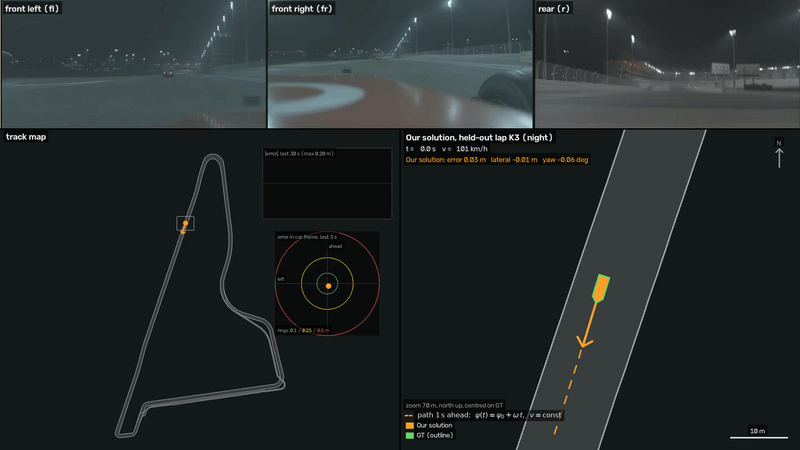

# cam_localization: camera-only localization on a race track

**Update (2026-10-20):** all code that builds the model is now in [`map_builder/`](map_builder/README.md):
`qwen_day.py` makes the synthetic day copy of the training run (Qwen-Image-Edit-2511), `build_map.sh` builds the
night map descriptors (SuperPoint, DINOv2), the keyframe poses / motion calibration and the day descriptor layer.

Constructor Labs challenge "Camera-based localization on a race track" (National AI Hackathon 2026).
At every camera set (7 cameras, 10 Hz) the localizer estimates the car pose `(x, y, yaw)` in the track frame from
the images, the camera calibration, the track borders and the car's motion state (speeds, yaw rate). It is causal:
the pose for set *t* uses only data up to *t*. GT is never read at inference.



## Quick start

```bash
./setup.sh                              # .venv with the pinned dependencies (Python 3.12, CUDA 12.8)
./download_model.sh                     # trained model -> model/ (8.6 GB from Google Drive, checked with sha256)
./run.sh RUN.mcap out/RUN X Y YAW       # first pose of the run given
./run.sh RUN.mcap out/RUN               # If first pose unknown: found by global relocalization
```

**Model download.** `download_model.sh` fetches `cam_localization_model.tar` (8.6 GB, sha256
`c3f01dac5a00e1a23b27b46c0f8175035d95a4aef4c7a7e2ec98136fc94506a5`) from Google Drive. Drive limits downloads of large
shared files; if the script stops with "Quota exceeded" (or any other error), download the archive by hand in a browser
from the [Google Drive folder](https://drive.google.com/drive/folders/1MiI1nSciCO-bJB_dFHq23Rb4BqsDERa2) ([direct link to the file](https://drive.google.com/file/d/1K050xbkpVElLbSnwAx3x5Msb2TL-sk6n/view)) and unpack it with the script:

```bash
MODEL_TAR=/path/to/cam_localization_model.tar ./download_model.sh      # checks the sha256, unpacks into model/
```

`out/RUN/poses.csv` is the pose file of the run: `timestamp_ns,x,y,yaw,confidence,status`, one row per camera set
(`timestamp_ns` = header stamp of the newest image of the set; `x`, `y` in metres and `yaw` in radians in the track
frame; `confidence` in [0, 1] = 1 - filter position std / 1.5 m; `status` `ok` or `lost` - `lost` while the
localizer has no pose yet (start without a first pose, first second) or has lost track (position std > 1.5 m or
10 failed corrections in a row)). The organisers' `tools/evaluate.py` reads it as it is (extra columns are ignored).
`frames.csv` has the measured time per set, `summary.json` the runtime statistics, the hardware and the localizer
statistics.

[submission/](submission/) holds the pose file of the only test-format run we have, the organisers' day lap
`rosbag_2026-10-13_16-08-46_cameras_lap` (`./run.sh` on it, no first pose; 730 of 739 poses `ok`, the first 9 `lost`
during the start). The pose file of the hidden test run is made the same way: `./run.sh TEST.mcap out/TEST`.

Inputs read from the mcap: `/constructor0/sensor/camera_*/compressed_image` and `camera_info`, `/tf_static`,
`/constructor0/track_bounds` (if missing, the bundled borders of the same circuit are used), and the car state from
`/constructor0/state_estimation`: only the fields whitelisted in `camloc/car_state.py`, the body-frame velocity
`vx_mps`, `vy_mps` and the yaw rate `wz_radps`. The pose fields (`x_m`, `y_m`, `yaw_rad`, `sn_map_state`, ...) are
never read, so the test run, where they are removed from the message, works unchanged; `/tf` (GT) is read only by
`tools/run.py` to report errors when it is present. If `state_estimation` is missing, the same quantities come from
`/constructor0/validation/twist` (body frame `constructor0/base_link`).

Checked on a test-like bag (training lap K3 re-written without `/tf` and with the pose fields removed from the
`state_estimation` schema): `./run.sh` without a first pose, held-out map, gives 0.072 m position RMSE, the same as
the validation run with GT available.

## Method

```
camera set (7 images) ──► SuperPoint (FP16, 1024 kp/camera) ──► guided matching to the keyframe map ──► robust pose
                                                                 (window around the predicted projection,      refinement,
car state (vx, vy, yaw rate) ──► EKF prediction ──► prior ───────►  keypoints + dense search, night OR day        all cameras
                                       ▲                             descriptor of each map point)                  │
                                       └──────────────────────────── EKF update ◄──────────────────────────────────┘
start / lost: DINOv2 retrieval + LightGlue + PnP-RANSAC over the whole map (global relocalization)
```

* **Map** (built from the night training run): keyframes along all laps with SuperPoint keypoints, descriptors and
  3D points (triangulated with the GT poses of the training run), DINOv2 global descriptors per keyframe.
* **Tracking**: the EKF (car state as motion input, speed scale and yaw-rate bias in the state) predicts the pose;
  map points of the 3 nearest keyframes are projected with it and matched inside a window (descriptor mutual best,
  plus a dense search in the SuperPoint descriptor map for the points left unmatched); the pose is refined on all
  cameras at once with robust least squares and fused into the EKF. A correction runs on every set.
* **Daylight**: the map is from a night session, the test may be by day. (1) Per-camera gamma maps the image
  brightness to the night median, saturated pixels (sun, glare) are masked, a failed correction is retried with
  relaxed thresholds, poses off the drivable area are rejected. (2) **Day descriptor layer**: every map point also
  has a day descriptor, computed at the same keyframe pixel on a day-styled copy of the training run (Qwen image
  editing: same geometry, other light). Matching uses `max(similarity to night, similarity to day)`, so night runs
  behave as before and day runs find ~3x more matches.
* **No first pose**: We have also tested our model without initial pose given, global relocalization on the first camera sets; the solutions are carried forward with the car
  state and voted on (median of the agreeing ones within 2 m); tracking starts once >= 3 (and at least half) agree.

Code (`camloc/`):

| module | content |
|---|---|
| `localizer.py` | **the localizer**: guided correction (exposure normalisation, glare mask, FP16 / compiled SuperPoint, keypoint + dense guided search with night and day descriptors, Gauss-Newton refinement, relaxed retry, drivable-area check), global relocalization when lost, start without a first pose |
| `localize.py` | keyframe map access; LightGlue + PnP-RANSAC + multi-camera refinement for the global relocalization |
| `track_filter.py` | EKF with car state (calibrated motion model); constant-velocity EKF for runs without car state |
| `global_desc.py`, `vislib.py` | DINOv2 global descriptor; SuperPoint + LightGlue of the global relocalization |
| `camera_model.py` | cameras: half-res intrinsics, extrinsics, body masks, projection |
| `bag.py`, `car_state.py` | mcap reading (calibration, camera sets, whitelisted car state, GT for validation only) |

## Results

Validation on the held-out laps K3 and K6 of the training run with the validation model (K3 / K6 excluded from the map,
the motion calibration and the day layer; see [Building the model](#building-the-model)), first pose = GT at the lap
start, RTX 5060 Ti 16 GB. Outputs of `tools/reproduce.sh` in [results/](results/README.md).

| run | pos RMSE [m] | lateral RMSE [m] | yaw RMSE [deg] | p95 [m] | < 1 m | time / set |
|---|---|---|---|---|---|---|
| K3, night | 0.071 | 0.025 | 0.050 | 0.143 | 100 % | 67 ms |
| K6, night | 0.081 | 0.044 | 0.082 | 0.176 | 100 % | 66 ms |
| K3, day (Qwen re-lit copy) | 0.076 | 0.034 | 0.059 | 0.151 | 100 % | 65 ms |
| K6, day (Qwen re-lit copy) | 0.086 | 0.051 | 0.081 | 0.184 | 100 % | 65 ms |
| K3 / K6, day, without the day layer | 0.114 / 0.134 | 0.053 / 0.067 | 0.085 / 0.102 | 0.218 / 0.260 | 100 % | |
| organisers' day lap (no GT, no first pose) | – | – | – | – | 730/730 corrections after the start, 0 failed | 69 ms |

Time per set = image decoding + `step()`; the camera period is 100 ms. Peak use: 7.5 GB GPU memory, 10.7 GB RAM.
Without a first pose the localizer starts after 10 sets (1 s) and reaches the same accuracy (K3 / K6 night
0.072 / 0.080 m, day 0.080 / 0.088 m; the larger max error is in the first second, before the start is fixed).
Caveat: the day copy of K3 / K6 and the day layer come from the same image editing model (the layer from the other
laps), so the day numbers are optimistic; the organisers' real day lap has no GT. On it the day layer raises the
median inliers per correction from 127 to 260 and removes all 21 failed corrections.

Validation command (K3; K6: `--start-s 896.1 --max-s 111.6`):

```bash
CAMLOC_MODEL=model_val .venv/bin/python tools/run.py --mcap TRAIN.mcap --out out/K3 --start-s 523.4 --max-s 110.6 \
    --map-config configs/map_val_k3k6.json --first-pose-from-gt --evaluate PATH/TO/tools/evaluate.py
```

## Model (`model/`, ~8 GB, not in git)

| file | content | built by |
|---|---|---|
| `features/db_<cam>.npz` | map keyframes: SuperPoint keypoints, descriptors, 3D points | [`map_builder/`](map_builder/README.md) (`db_build.py`) |
| `features/global_<cam>.npy`, `set_stamps.npy` | DINOv2 global descriptors of the training-run frames | `map_builder/global_desc.py`, `write_set_stamps.py` |
| `masks/<cam>.png` | car-body masks | `map_builder/make_masks.py` |
| `kf_poses.npz` | GT pose of every map keyframe | `map_builder/build_model.py` |
| `motion_calib.json` | car state -> body motion calibration | `map_builder/build_model.py` |
| `night_stats.json` | median grey of the night keyframes per camera | `map_builder/build_model.py` |
| `track_bounds.npz` | track / pit-lane borders | `map_builder/build_model.py` |
| `day/day_<cam>.npy`, `day/day_meta.json` | day descriptor layer | `map_builder/build_day_layer.py` |

## Building the model

Inputs: the training run `TRAIN.mcap` (with GT `/tf`) and a day-styled copy of it (`DAY*.mcap`: the same bag with
every image re-lit night -> day, here with a Qwen image editing model; it may come in several files). The map
(`features/`, `masks/`) comes from the model archive; it is rebuilt from `TRAIN.mcap` by
`map_builder/build_map.sh TRAIN.mcap model` (~3 h, GPU, see [map_builder/](map_builder/README.md)).

```bash
# 1. keyframe poses, motion calibration (complete laps 1-7), night brightness, track borders   (~30 s, CPU)
.venv/bin/python map_builder/build_model.py --mcap TRAIN.mcap
# 2. day descriptor layer from all laps                                        (~2 min per 8 GB of day bags, GPU)
.venv/bin/python map_builder/build_day_layer.py --mcap DAY_part1.mcap DAY_part2.mcap
# 3. pack for distribution (download_model.sh unpacks it into model/)
tar -cf cam_localization_model.tar model && sha256sum cam_localization_model.tar
```

Both tools write new files and rename them into place, so a hard-linked copy of `model/` (`cp -al`) is never
changed. Laps (`configs/laps.csv`, seconds from the first GT stamp): K0 0-185.5 (pit), K1 185.5-365.6,
K2 365.6-523.4, K3 523.4-634.0, K4 634.0-752.2, K5 752.2-896.1, K6 896.1-1007.7, K7 1007.7-1120.7,
K8 1120.7-1194.4 (partial).

**Submission model vs. validation model.** The submission model uses all the data: every map keyframe at run time
(`configs/map_full.json`), the motion calibration from all complete laps 1-7 and the day layer from all laps. A
held-out check on K3 / K6 needs a validation model in which neither the calibration nor the day layer has seen them:

```bash
cp -al model model_val                                                 # hard-linked copy (no extra disk space)
.venv/bin/python map_builder/build_model.py --mcap TRAIN.mcap --laps 1 2 4 5 7 --out model_val
.venv/bin/python map_builder/build_day_layer.py --mcap DAY.mcap --map-config configs/map_val_k3k6.json --out model_val/day
```

`tools/reproduce.sh` does all of it (both models, then every run in `results/`):

```bash
TRAIN=.../c0_2026-10-13_22-53-42_camloc_0.mcap DAY=.../qwen_full.mcap EVAL=.../tools/evaluate.py \
DAYLAP=.../rosbag_2026-10-13_16-08-46_cameras_lap_0.mcap tools/reproduce.sh out/val
```

**State of the current model archive** (2026-10-18): the submission model, built from all data. Map, global
descriptors, keyframe poses, night brightness and track borders cover all laps; the motion calibration uses laps 1-7;
the day layer is built from the complete Qwen day copy of the training run (`qwen_full.mcap`) and covers every
keyframe and camera.

## Pretrained models and external data (declared)

* DINOv2 ViT-S/14 (Meta, `facebookresearch/dinov2` via torch.hub) - global descriptors.
* SuperPoint and LightGlue weights (`cvg/LightGlue`) - keypoints, descriptors, matching.
* Qwen image editing model - only offline, to re-light the training images night -> day for the day layer
  (exact checkpoint: (https://huggingface.co/Qwen/Qwen-Image-Edit-2511)).
* No external datasets; the map is built from the provided training run.

## Configuration

| variable | default | meaning |
|---|---|---|
| `CAMLOC_MODEL` | `model/` | model directory |
| `LOC_MAP_CONFIG` | `configs/map_full.json` | map subset (`tools/run.py --map-config`) |
| `CAMLOC_DAY` | `1` | day descriptor layer on / off (0: night descriptors only, ablation) |
| `CAMLOC_DAY_DIR` | `model/day/` | day descriptor layer directory |
| `CAMLOC_COMPILE` | `1` | `torch.compile` of the SuperPoint backbone (0: eager, if compiling fails on a machine) |
| `CAMLOC_BOOT_*` | see `camloc/localizer.py` | start without a first pose |
| `TORCH_HOME` | `.torch/` | cache of the pretrained weights |
